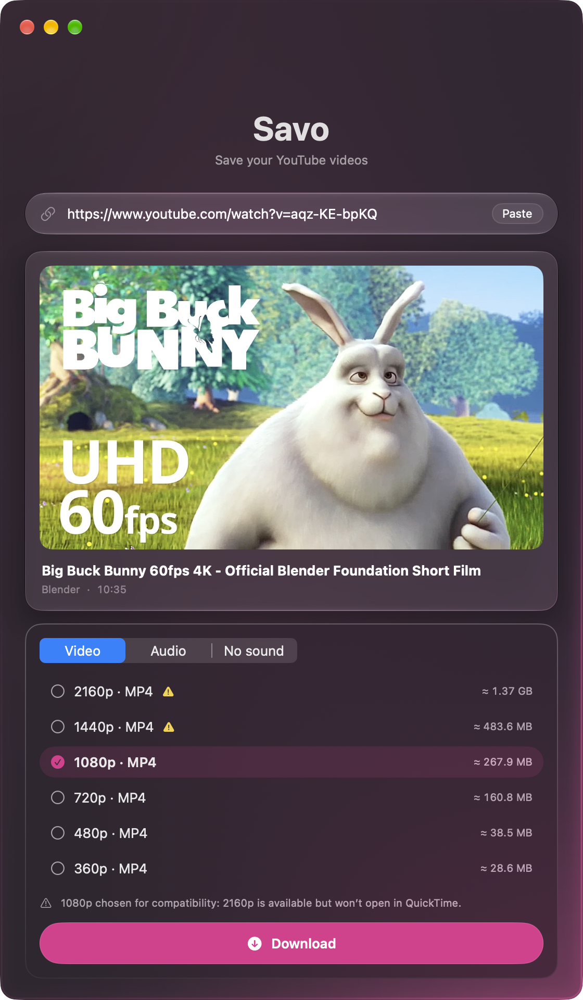
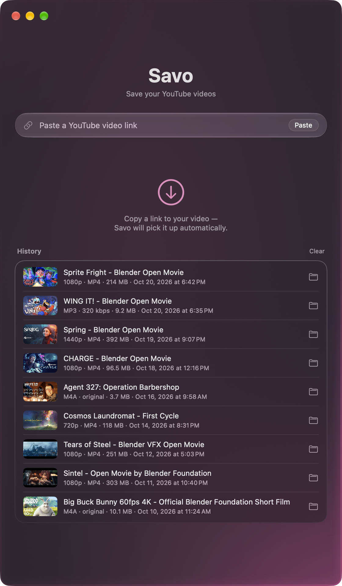

<p align="center">
  
</p>

<h1 align="center">Savo</h1>

<p align="center">
  <b>Save your YouTube videos on a Mac — paste a link, get the file.</b><br>
  Streams and unlisted videos included, in the quality you pick, ready for QuickTime.
</p>

<p align="center">
  <b>English</b> · <a href="README.ru.md">Русский</a>
</p>

<p align="center">
  <a href="https://github.com/ippitenin/SAVO-macOS/releases/latest"></a>
  <a href="https://github.com/ippitenin/SAVO-macOS/actions/workflows/build.yml"></a>
  
  
  <a href="LICENSE"></a>
</p>

<p align="center">
  <a href="https://github.com/ippitenin/SAVO-macOS/releases/latest/download/Savo.dmg"></a>
  <br>
  <sub>Apple silicon · macOS 14 or later · signed and notarized by Apple</sub>
</p>

<table align="center">
  <tr>
    <td width="50%" valign="top"></td>
    <td width="50%" valign="top"></td>
  </tr>
  <tr>
    <td align="center"><sub>Only the qualities the video really has</sub></td>
    <td align="center"><sub>Every download stays one click from Finder</sub></td>
  </tr>
</table>

Savo was made for one job: saving the videos of your own YouTube channel — public, unlisted
and past live streams — without a terminal. The download engine (yt-dlp with ffmpeg and deno)
ships inside the app and keeps itself up to date, so there is nothing to install with Homebrew
or Python.

## Features

<table>
  <tr>
    <td width="50%" valign="top">
      <h3>🔗 Paste a link</h3>
      A card with the thumbnail, title, channel and duration appears in a second. Savo can also pick a link up from the clipboard on its own.
    </td>
    <td width="50%" valign="top">
      <h3>🎚️ Only real qualities</h3>
      2160p … 360p, named the way YouTube names them, with the file size. If YouTube won't serve the quality you chose, Savo says so instead of quietly downloading a worse one.
    </td>
  </tr>
  <tr>
    <td width="50%" valign="top">
      <h3>▶️ Opens in QuickTime</h3>
      The default is the highest H.264 variant, so the file plays with a double click. Qualities that exist only as VP9 or AV1 are marked.
    </td>
    <td width="50%" valign="top">
      <h3>🎧 Audio or muted video</h3>
      The original M4A, MP3 at 320, 192 or 128 kbps, or just the video track without sound — for editing.
    </td>
  </tr>
  <tr>
    <td width="50%" valign="top">
      <h3>📈 One honest progress bar</h3>
      Video and audio fill a single bar in proportion to their size, with speed and time left. No bar that hits 100% and starts over.
    </td>
    <td width="50%" valign="top">
      <h3>🧹 A tidy Downloads folder</h3>
      Partial files live elsewhere, cancelling cleans up, and names read like <code>Title [28.09.2026, 1080p].mp4</code> — different qualities never overwrite each other.
    </td>
  </tr>
  <tr>
    <td width="50%" valign="top">
      <h3>🔄 An engine that stays fresh</h3>
      Once a day Savo checks for a new yt-dlp, verifies its SHA-256 and swaps it in atomically — never in the middle of a download.
    </td>
    <td width="50%" valign="top">
      <h3>🛟 Errors in plain words</h3>
      A refusal from YouTube is retried with another player client first. Rate limits, private videos and a dropped connection get their own messages — with a VPN hint when YouTube is unreachable.
    </td>
  </tr>
</table>

<details>
<summary><b>All features in detail</b></summary>

- **Paste a link** — a card with the thumbnail, title, channel and duration appears.
  Picking a YouTube link up from the clipboard when you switch to Savo is optional
  (off by default).
- **Three kinds of downloads** — *Video* (MP4 with sound), *Audio* (original M4A or
  MP3 at 320/192/128 kbps) and *Muted* (video track only). Only the qualities the
  video really has are offered, with an estimated file size.
- **Quality named the way YouTube names it** — 2160p … 360p, also for non-16:9 and
  vertical videos (a 3840×1920 video is “2160p”, not “1920p”). The format selector is
  strict: if YouTube does not serve the chosen quality, Savo says so instead of
  silently downloading a lower one.
- **Opens in QuickTime** — the default is the highest H.264 variant; qualities that
  exist only as VP9/AV1 are marked.
- **Readable file names** — `Title [28.09.2026, 1080p].mp4`: the upload date tells
  same-titled streams apart, and different qualities of one video never overwrite
  each other.
- **Progress** as one bar for the whole download — video and audio fill it in
  proportion to their size, no reset between tracks — with speed, time left and a
  merging step at the end. Cancelling cleans up temporary files; partial downloads
  never land in your Downloads folder.
- **History** of recent downloads with “Show in Finder”; it survives restarts and
  tolerates a damaged record instead of losing everything.
- **An engine that stays fresh** — once a day Savo checks GitHub for a new yt-dlp,
  verifies its SHA-256 and swaps it in atomically, never in the middle of a
  download. “Update engine” in Settings does the same on demand.
- **Clear errors** — when YouTube refuses (403, “not a bot”, missing format) Savo
  retries with another player client first; rate limits and private videos get
  their own messages. A dropped connection or a blocked YouTube (connection reset,
  broken TLS handshake) is recognized too, with a hint to turn on a system-wide VPN.
- **Diagnostics** — “Copy debug report” in Settings (versions, Mac model, engine
  start-up time, recent downloads, log tail) and the engine log at
  `~/Library/Logs/Savo/engine.log`.
- **Current macOS look** — Liquid Glass on macOS 26/27, a material fallback on 14/15,
  light and dark themes, Reduce Motion and Reduce Transparency respected.
- **English and Russian** interface.

</details>

## Install

1. Download **[Savo.dmg](https://github.com/ippitenin/SAVO-macOS/releases/latest/download/Savo.dmg)** from the latest release.
2. Open it and drag Savo to Applications.
3. Launch Savo and paste a link. On the very first launch Savo unpacks its download engine,
   which takes a few seconds once.

**Requirements:** a Mac with Apple silicon (M1 or newer) and macOS 14 Sonoma or later. Intel Macs
are not supported.

## Privacy

Savo has no account, no analytics and no server of its own. It talks to exactly two places:

| Where | Why |
|---|---|
| YouTube | Video info and the download itself (through yt-dlp) |
| GitHub | Once a day: is there a new yt-dlp? The update is checked against its SHA-256 |

Everything else stays on your Mac: files go to the folder you choose (Downloads by default),
the history lives in `~/Library/Application Support/Savo`, and the engine log in
`~/Library/Logs/Savo/engine.log`.

## Build from source

```bash
git clone https://github.com/ippitenin/SAVO-macOS.git
cd SAVO-macOS/Savo-app
scripts/fetch-binaries.sh   # yt-dlp (onedir), ffmpeg, deno → Vendor/bin (not in git)
./build.sh                  # arm64 build, signing, install to ~/Applications
./build.sh --dmg            # the same plus Savo.dmg in the repository root
./run.sh                    # build and launch
```

Building needs Xcode 26 or newer: the current system look depends on the SDK the app is built
with.

- `fetch-binaries.sh` checks the yt-dlp archive against the release `SHA2-256SUMS`
  and makes sure every binary has an arm64 slice. Pin a yt-dlp version with
  `YTDLP_TAG=2026.08.19 scripts/fetch-binaries.sh`.
- Signing picks the best identity available: a “Developer ID Application” certificate
  from the keychain (hardened runtime; `--dmg` also notarizes both the app and the image
  with Apple and staples the tickets — `notarytool` profile `apps-notary`, override with
  `SAVO_NOTARY_PROFILE`), else a local “Savo Dev” certificate
  (`scripts/make-dev-cert.md`), else ad-hoc. Without Developer ID the first launch on
  another Mac needs right-click → Open.
- `scripts/release.sh` publishes a release: the version from `Info.plist`, a notarized
  DMG, the tag and the GitHub release page. CI (`.github/workflows`) builds every pull
  request without warnings, checks the localization and, for tags, the DMG.

<details>
<summary><b>How it works</b></summary>

- **AppKit shell, SwiftUI content.** `DownloadController` is a small state machine:
  idle → fetching info → ready → downloading → done / failed.
- **Engine.** The bundle carries yt-dlp as the upstream onedir archive. On first
  launch it is unpacked into `~/Library/Application Support/Savo/bin`, test-run and
  used from there — the onedir build starts in ~0.2 s, the one-file build took ~7 s
  on every launch. Updates replace the whole folder with a single atomic rename.
  Every external process goes through `ProcessRunner`.
- **Notarization.** Apple unpacks nested archives and checks every binary inside, so
  for a Developer ID build `build.sh` re-signs all ~100 binaries of the yt-dlp archive
  with the hardened runtime. ffmpeg and deno keep their authors' Developer ID
  signatures.
- **Layout** (`Savo-app/Sources/Savo`):
  - `Engine/` — installer, updater, process runner, yt-dlp client, progress parser,
    errors, engine log;
  - `Model/` — link validation, video info, quality presets (pure logic);
  - `Controllers/` — the download state machine;
  - `Storage/` — history and settings;
  - `Diagnostics/` — the debug report;
  - `UI/` — windows and views, `UI/DesignSystem/` — design tokens, glass, buttons.

Developer notes and the pitfalls we already hit live in [`CLAUDE.md`](CLAUDE.md)
(in Russian).

</details>

## Third-party components

Downloaded by `scripts/fetch-binaries.sh` at build time and bundled into the app; they are
not stored in this repository.

- [yt-dlp](https://github.com/yt-dlp/yt-dlp) — Unlicense (public domain); its onedir build
  bundles Python and its libraries under their own licenses.
- [FFmpeg](https://ffmpeg.org) — GPL-3.0, static arm64 build from
  [ffmpeg.martin-riedl.de](https://ffmpeg.martin-riedl.de).
- [Deno](https://deno.com) — MIT.

The screenshots show open movies by [Blender Studio](https://studio.blender.org) — Sprite Fright,
Spring, Charge, Wing It!, Agent 327, Cosmos Laundromat, Tears of Steel, Sintel and Big Buck
Bunny — released under Creative Commons Attribution licenses.

## Responsible use

Savo is meant for content you own or have permission to download — your own channel, or
videos released under a license that allows it. Respect YouTube's Terms of Service and
copyright.

## See also

[DOKA](https://github.com/ippitenin/DOKA-macOS) — voice dictation and transcription for macOS,
by the same author.

## License

[GPL-3.0](LICENSE) © Ilya Pitenin

GPL-3.0 lets you use, study, change and share Savo. Any copy or derivative work — code,
interface texts or design — must also be distributed under GPL-3.0, with its complete source
code and the original copyright notice.
