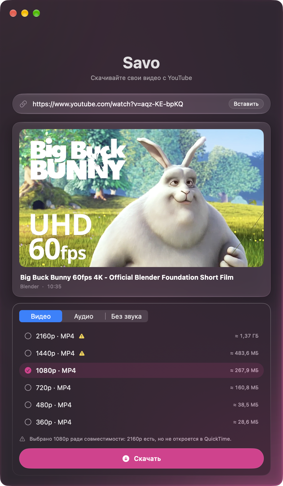
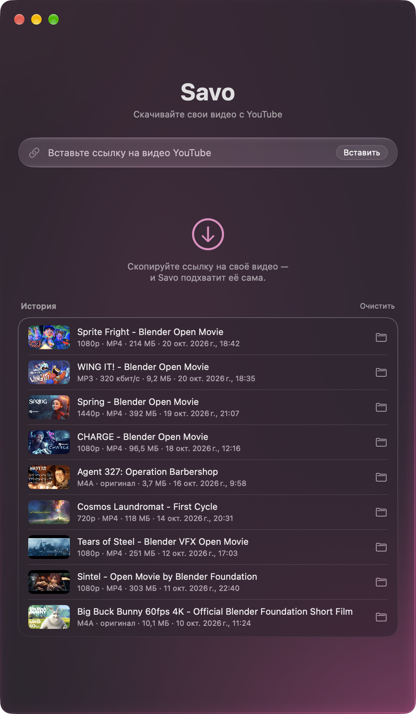

<p align="center">
  
</p>

<h1 align="center">Savo</h1>

<p align="center">
  <b>Ваши видео с YouTube на Mac — вставил ссылку, получил файл.</b><br>
  Эфиры и ролики «по ссылке» тоже, в выбранном качестве и сразу для QuickTime.
</p>

<p align="center">
  <a href="README.md">English</a> · <b>Русский</b>
</p>

<p align="center">
  <a href="https://github.com/ippitenin/SAVO-macOS/releases/latest"></a>
  <a href="https://github.com/ippitenin/SAVO-macOS/actions/workflows/build.yml"></a>
  
  
  <a href="LICENSE"></a>
</p>

<p align="center">
  <a href="https://github.com/ippitenin/SAVO-macOS/releases/latest/download/Savo.dmg"></a>
  <br>
  <sub>Apple silicon · macOS 14 и новее · подписано и нотаризовано Apple</sub>
</p>

<table align="center">
  <tr>
    <td width="50%" valign="top"></td>
    <td width="50%" valign="top"></td>
  </tr>
  <tr>
    <td align="center"><sub>Только те качества, что есть у ролика</sub></td>
    <td align="center"><sub>Любая загрузка — в один клик от Finder</sub></td>
  </tr>
</table>

Savo сделан для одной задачи: сохранять ролики своего YouTube-канала — открытые, доступные
по ссылке и прошедшие эфиры — без терминала. Движок скачивания (yt-dlp с ffmpeg и deno) уже
внутри приложения и обновляется сам, так что ставить через Homebrew или Python ничего не нужно.

## Возможности

<table>
  <tr>
    <td width="50%" valign="top">
      <h3>🔗 Вставил ссылку</h3>
      Через секунду — карточка с превью, названием, каналом и длительностью. Savo умеет и сам подхватить ссылку из буфера обмена.
    </td>
    <td width="50%" valign="top">
      <h3>🎚️ Только настоящие качества</h3>
      2160p … 360p — как их называет YouTube, с размером файла. Если YouTube не отдаёт выбранное качество, Savo так и скажет, а не скачает тихо похуже.
    </td>
  </tr>
  <tr>
    <td width="50%" valign="top">
      <h3>▶️ Открывается в QuickTime</h3>
      По умолчанию — самое высокое качество в H.264, файл играет по двойному клику. Качества, которые есть только в VP9 или AV1, помечены.
    </td>
    <td width="50%" valign="top">
      <h3>🎧 Звук или видео без звука</h3>
      Оригинальный M4A, MP3 на 320, 192 или 128 кбит/с — или одна видеодорожка без звука, для монтажа.
    </td>
  </tr>
  <tr>
    <td width="50%" valign="top">
      <h3>📈 Одна честная полоса</h3>
      Видео и звук заполняют одну полосу по доле своего размера, со скоростью и остатком времени. Никаких «100%, и всё сначала».
    </td>
    <td width="50%" valign="top">
      <h3>🧹 Чистые «Загрузки»</h3>
      Недокачанное лежит отдельно, отмена всё подчищает, а имена файлов понятные: <code>Название [28.09.2026, 1080p].mp4</code> — разные качества не затирают друг друга.
    </td>
  </tr>
  <tr>
    <td width="50%" valign="top">
      <h3>🔄 Движок не устаревает</h3>
      Раз в сутки Savo проверяет новую версию yt-dlp, сверяет SHA-256 и подменяет её атомарно — никогда посреди загрузки.
    </td>
    <td width="50%" valign="top">
      <h3>🛟 Ошибки человеческим языком</h3>
      Отказ YouTube сначала лечится другим клиентом. На лимит запросов, приватные видео и обрыв связи — свои сообщения, с подсказкой про VPN, если YouTube недоступен.
    </td>
  </tr>
</table>

<details>
<summary><b>Все возможности подробно</b></summary>

- **Вставка ссылки** — появляется карточка с превью, названием, каналом и длительностью.
  Подхват YouTube-ссылки из буфера при переключении на Savo включается в настройках
  (по умолчанию выключен).
- **Три вида загрузки** — *Видео* (MP4 со звуком), *Аудио* (оригинальный M4A или MP3
  320/192/128 кбит/с) и *Без звука* (только видеодорожка). Предлагаются только те
  качества, что реально есть у ролика, с примерным размером файла.
- **Качество называется как на YouTube** — 2160p … 360p, в том числе у роликов не 16:9 и
  вертикальных (кадр 3840×1920 — это «2160p», а не «1920p»). Выбор формата строгий: если
  YouTube не отдаёт выбранное качество, Savo говорит об этом, а не скачивает молча
  меньшее.
- **Открывается в QuickTime** — по умолчанию выбирается самый высокий вариант в H.264;
  качества, которые есть только в VP9/AV1, помечены.
- **Понятные имена файлов** — `Название [28.09.2026, 1080p].mp4`: дата публикации
  различает одноимённые эфиры, а разные качества одного ролика не затирают друг друга.
- **Прогресс** — одна полоса на всё скачивание: видео и звук заполняют её по доле
  своего размера, без сброса между дорожками; скорость, остаток времени, в конце —
  сведение. Отмена подчищает временные файлы; недокачанные огрызки в «Загрузки» не
  попадают.
- **История** последних загрузок с «Показать в Finder»; переживает перезапуск, а
  битая запись отбрасывается поштучно, не обнуляя всю историю.
- **Движок не устаревает** — раз в сутки Savo проверяет новую версию yt-dlp на
  GitHub, сверяет SHA-256 и подменяет её атомарно, никогда посреди загрузки.
  «Обновить движок» в настройках делает то же по кнопке.
- **Понятные ошибки** — при отказе YouTube (403, «не робот», нет формата) Savo сначала
  пробует другой клиент; на лимит запросов и приватные видео — свои сообщения.
  Обрыв связи и блокировку YouTube (сброс соединения, оборванное TLS-рукопожатие)
  Savo тоже распознаёт и подсказывает включить VPN для всего Mac.
- **Диагностика** — «Скопировать отчёт» в настройках (версии, модель Mac, скорость
  старта движка, последние загрузки, хвост журнала) и журнал движка
  `~/Library/Logs/Savo/engine.log`.
- **Современный вид macOS** — Liquid Glass на macOS 26/27, материалы на 14/15, светлая
  и тёмная темы, учитываются «Уменьшение движения» и «Понижение прозрачности».
- **Интерфейс на русском и английском.**

</details>

## Установка

1. Скачайте **[Savo.dmg](https://github.com/ippitenin/SAVO-macOS/releases/latest/download/Savo.dmg)** из последнего релиза.
2. Откройте его и перетащите Savo в «Программы».
3. Запустите Savo и вставьте ссылку. При самом первом запуске Savo распаковывает движок
   скачивания — это несколько секунд один раз.

**Требования:** Mac с чипом Apple (M1 и новее) и macOS 14 Sonoma или новее. Mac с процессором
Intel не поддерживаются.

## Приватность

У Savo нет аккаунта, аналитики и своего сервера. Он обращается ровно в два места:

| Куда | Зачем |
|---|---|
| YouTube | Сведения о ролике и само скачивание (через yt-dlp) |
| GitHub | Раз в сутки: не вышел ли новый yt-dlp? Обновление сверяется по SHA-256 |

Всё остальное остаётся на вашем Mac: файлы — в выбранной папке (по умолчанию «Загрузки»),
история — в `~/Library/Application Support/Savo`, журнал движка —
`~/Library/Logs/Savo/engine.log`.

## Сборка из исходников

```bash
git clone https://github.com/ippitenin/SAVO-macOS.git
cd SAVO-macOS/Savo-app
scripts/fetch-binaries.sh   # yt-dlp (onedir), ffmpeg, deno → Vendor/bin (не в git)
./build.sh                  # сборка arm64, подпись, установка в ~/Applications
./build.sh --dmg            # то же плюс Savo.dmg в корне репозитория
./run.sh                    # сборка и запуск
```

Для сборки нужен Xcode 26 или новее: современный вид системы зависит от SDK, с которым
собрано приложение.

- `fetch-binaries.sh` сверяет архив yt-dlp с `SHA2-256SUMS` релиза и проверяет, что у
  каждого бинарника есть arm64. Закрепить версию yt-dlp:
  `YTDLP_TAG=2026.08.19 scripts/fetch-binaries.sh`.
- Подпись — лучшая из доступных: сертификат «Developer ID Application» из связки ключей
  (hardened runtime; `--dmg` ещё и нотаризует у Apple приложение и образ и прикрепляет
  квитанции —
  профиль `notarytool` `apps-notary`, другой задаётся `SAVO_NOTARY_PROFILE`), иначе
  локальный «Savo Dev» (`scripts/make-dev-cert.md`), иначе ad-hoc. Без Developer ID первый
  запуск на другом Mac — правый клик → «Открыть».
- `scripts/release.sh` публикует релиз: версия из `Info.plist`, нотаризованный DMG, тег и
  страница релиза на GitHub. CI (`.github/workflows`) собирает каждый pull request без
  предупреждений, проверяет локализацию, а для тегов — и DMG.

<details>
<summary><b>Как устроено</b></summary>

- **AppKit-каркас, контент на SwiftUI.** `DownloadController` — небольшой конечный
  автомат: idle → получение сведений → ready → скачивание → done / failed.
- **Движок.** В бандле yt-dlp лежит onedir-архивом релиза. При первом запуске он
  распаковывается в `~/Library/Application Support/Savo/bin`, проходит проверочный
  запуск и дальше работает оттуда — onedir стартует за ~0,2 с, а onefile тратил ~7 с на
  каждый запуск. Обновление подменяет всю папку одним атомарным переименованием. Все
  внешние процессы запускаются через `ProcessRunner`.
- **Нотаризация.** Apple распаковывает вложенные архивы и проверяет каждый бинарник
  внутри, поэтому при сборке с Developer ID `build.sh` переподписывает все ~100
  бинарников архива yt-dlp с hardened runtime. ffmpeg и deno сохраняют подписи
  Developer ID своих авторов.
- **Структура** (`Savo-app/Sources/Savo`):
  - `Engine/` — установщик, апдейтер, запуск процессов, клиент yt-dlp, разбор
    прогресса, ошибки, журнал движка;
  - `Model/` — проверка ссылок, сведения о видео, пресеты качества (чистая логика);
  - `Controllers/` — конечный автомат загрузки;
  - `Storage/` — история и настройки;
  - `Diagnostics/` — отчёт для диагностики;
  - `UI/` — окна и вью, `UI/DesignSystem/` — дизайн-токены, стекло, кнопки.

Заметки для разработки и ловушки, на которые мы уже наступили, — в [`CLAUDE.md`](CLAUDE.md).

</details>

## Сторонние компоненты

Скачиваются `scripts/fetch-binaries.sh` при сборке и вкладываются в приложение; в
репозитории не хранятся.

- [yt-dlp](https://github.com/yt-dlp/yt-dlp) — Unlicense (общественное достояние); его
  onedir-сборка включает Python и библиотеки под их собственными лицензиями.
- [FFmpeg](https://ffmpeg.org) — GPL-3.0, статическая arm64-сборка
  [ffmpeg.martin-riedl.de](https://ffmpeg.martin-riedl.de).
- [Deno](https://deno.com) — MIT.

На скриншотах — открытые фильмы [Blender Studio](https://studio.blender.org): Sprite Fright,
Spring, Charge, Wing It!, Agent 327, Cosmos Laundromat, Tears of Steel, Sintel и Big Buck
Bunny, выпущенные под лицензиями Creative Commons Attribution.

## Ответственное использование

Savo предназначен для контента, который принадлежит вам или который вам разрешено
скачивать, — вашего канала или роликов под лицензией, которая это позволяет. Соблюдайте
условия YouTube и авторское право.

## Смотрите также

[DOKA](https://github.com/ippitenin/DOKA-macOS) — голосовой ввод и расшифровка для macOS,
от того же автора.

## Лицензия

[GPL-3.0](LICENSE) © Илья Питенин

GPL-3.0 разрешает использовать, изучать, изменять и распространять Savo. Любая копия или
производная работа — код, тексты интерфейса или дизайн — тоже должна распространяться под
GPL-3.0, с полным исходным кодом и исходным уведомлением об авторских правах.
